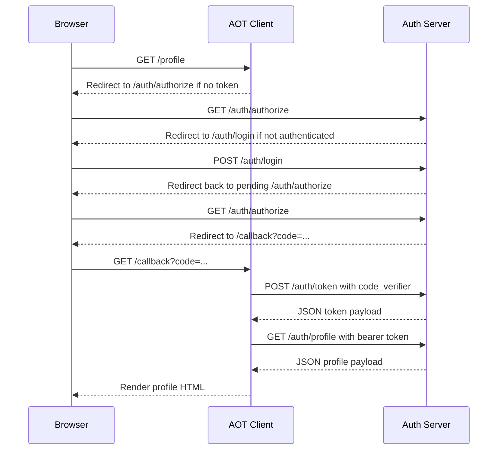

# Architecture Overview

## Purpose

ALT-Identity provides a compact local identity service that behaves enough like
an OAuth 2.0 / OIDC authorization-code flow to support early integration work,
test automation, and demos.

## Main Components

### `auth_server`

The identity-provider app. It is responsible for:

- authenticating users with Django's built-in auth system
- issuing authorization codes
- storing PKCE challenges on authorization codes
- exchanging authorization codes for access and refresh tokens
- serving a protected profile endpoint
- logging the browser session out

### `aot`

The bundled demo client, acting as a small relying-party application. It is
responsible for:

- starting the authorization flow
- handling the callback
- exchanging the authorization code for tokens
- storing tokens in the browser session
- requesting the protected profile endpoint
- rendering the profile response as human-readable HTML

### `resource_server`

Currently a placeholder. It exists as the natural home for future protected APIs
if the project grows beyond a single profile endpoint.

## Data Model

### `AuthCode`

Represents a short-lived authorization code bound to:

- a username
- a client id
- a redirect URI
- an optional scope string
- an expiry timestamp
- a single-use flag

### `Token`

Represents issued token material, including:

- access token
- refresh token
- token type
- user name
- client id
- issued scope
- creation timestamp

### `UserProfile`

Adds simple profile data to Django's built-in `User`. Right now the exposed demo
attribute is `learning_goal`.

## Request Flow

## Session Boundaries

Two different storage mechanisms are used:

- Django browser session:
  - login state for the human user
  - bundled demo client's `access_token` and `refresh_token`
- Database models:
  - issued authorization codes
  - issued tokens
  - user profile data

## Security Posture

This repository is intentionally lightweight. Its architecture is appropriate for
local development and test environments, not for production identity workloads.

Important simplifications:

- no client registry
- no client secret validation
- no signed JWTs
- no refresh-token exchange endpoint
- no consent UI
- limited scope handling
- limited redirect-URI validation

PKCE is supported for authorization-code exchanges and is used by the bundled
demo client with the `S256` method.

## Extension Points

Teams commonly evolve this architecture by:

- separating identity-provider and resource-server concerns
- adding client registration and environment-specific configuration
- enforcing token expiry and revocation
- implementing refresh-token and introspection endpoints
- adding richer claims to `UserProfile`
- replacing local session token storage with a more formal client strategy
