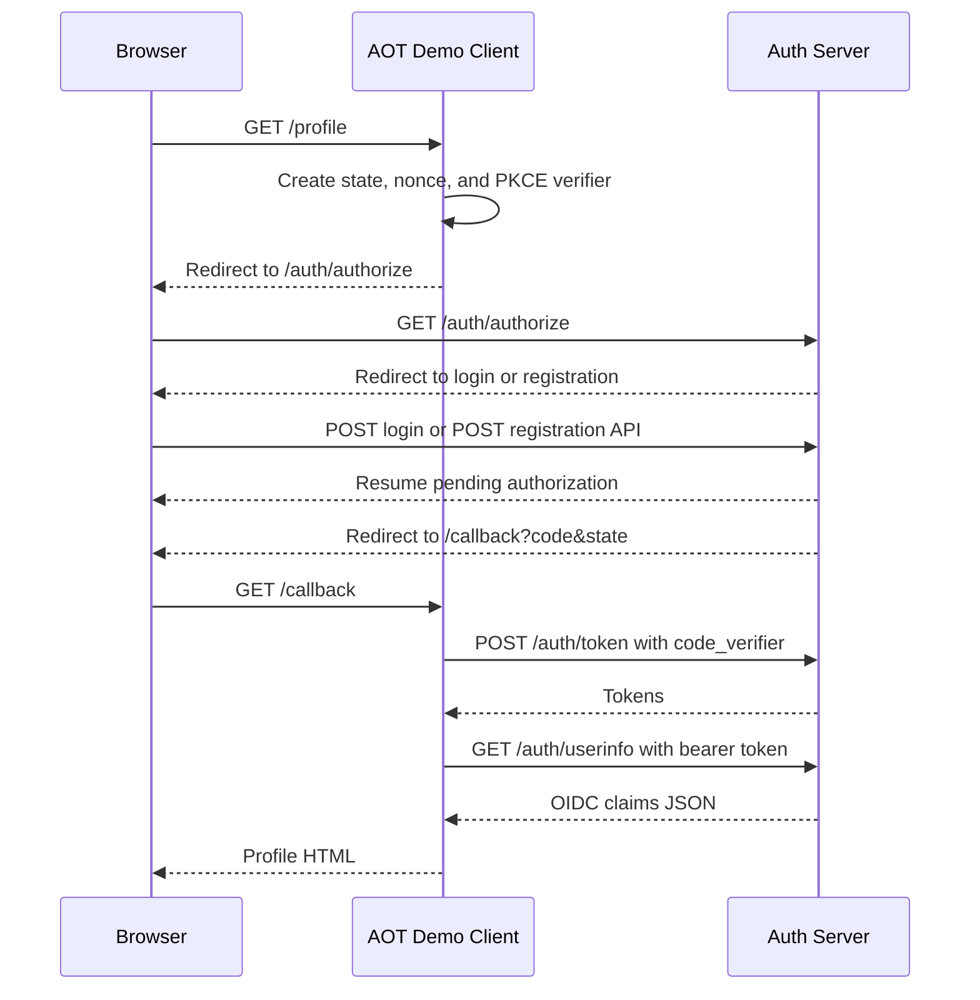

# ALT-Identity Project Specification

## Purpose

ALT-Identity is a Django-based local OpenID Connect (OIDC) provider for development, demos, and automated integration testing. It implements a standards-shaped OAuth 2.0 authorization-code flow with PKCE and includes a bundled relying-party demo application that exercises the flow end to end.

It is intentionally not a production identity provider and is not designed for internet-facing, multi-tenant, or high-availability use.

## Architecture

The Django project is in `identity-service/` and has three applications.

| Application | Responsibility |
| --- | --- |
| `auth_server` | Local identity provider: login, registration, authorization, token, logout, discovery, JWKS, and UserInfo. |
| `aot` | Bundled relying-party demo. It runs the authorization-code flow, stores received tokens in session, and renders UserInfo. |
| `resource_server` | Placeholder for future protected APIs. It has no active routes or implementation. |

Top-level routes are owned as follows:

| Route prefix | Owner |
| --- | --- |
| `/` | `aot` demo client |
| `/auth/` | `auth_server` identity provider |
| `/.well-known/` | OIDC discovery and JWKS |
| `/admin/` | Django admin |

## Runtime

### Dependencies

- Python 3.14 or newer
- Django 6.0.6 or newer
- PyJWT and cryptography
- OpenSSL command-line tools for RS256 signing and JWKS generation
- SQLite by default at `identity-service/db.sqlite3`

### Configuration

| Setting | Default | Meaning |
| --- | --- | --- |
| `ALT_IDENTITY_ISSUER` | `http://localhost:8000` | Public issuer and base URL used in metadata and ID tokens. |
| `ALT_IDENTITY_ALLOWED_HOSTS` | `localhost,127.0.0.1` | Comma-separated Django hosts. |
| `ALT_IDENTITY_SESSION_COOKIE_NAME` | `alt_identity_sessionid` | Browser session-cookie name. |
| `ALT_IDENTITY_OIDC_PRIVATE_KEY_PEM` | unset | RSA private key for RS256 ID tokens. Required to issue an ID token. |
| `ALT_IDENTITY_OIDC_PUBLIC_KEY_PEM` | unset | RSA public key for JWKS; derived from the private key when omitted. |
| `ALT_IDENTITY_OIDC_KEY_ID` | `dev-rs256-1` | JWT and JWKS key identifier. |
| `ALT_IDENTITY_TEST_REGISTRATION_API_ENABLED` | `false` | Enables the JSON test registration API for `1`, `true`, `yes`, or `on`. |
| `ALT_IDENTITY_VERBOSE_HTTP_LOGGING` | `True` | Enables inbound, outbound, and response logging. |

`run.sh` resolves `manage.py` relative to the repository, detects a LAN address, generates temporary RSA keys under `/tmp`, starts Django on port `8900`, and enables the test-registration API unless the variable is explicitly set.

## Persistence

| Model | Purpose | Key behavior |
| --- | --- | --- |
| Django `User` | Authentication and primary profile names | Stores username, password hash, first name, and last name. |
| `UserProfile` | Optional extended profile data | One-to-one with `User`; currently stores `learning_goal`. |
| `Client` | Relying-party configuration | Stores client ID, newline-separated redirect URIs, scopes, and confidentiality flag. |
| `AuthCode` | Authorization-code state | Stores client, user, scope, redirect URI, state, nonce, PKCE challenge, expiry, and a single-use flag. Codes last five minutes. |
| `Token` | Opaque issued tokens | Stores access/refresh strings, user, client, scope, and TTL. Access tokens last 3600 seconds. |

## Session State

One Django session carries both user authentication and demo-client state.

| Key | Use |
| --- | --- |
| Django auth session keys | Logged-in local user. |
| `pending_authorization` | Original authorize URL restored after login or registration. |
| `pkce_code_verifier` | Created before authorization; used during token exchange. |
| `oidc_state` | Callback anti-forgery value. |
| `oidc_nonce` | Included in the ID token. |
| `access_token`, `refresh_token`, `id_token` | Token values held by the demo client. |

## Routes

### Demo client

| Method | Route | Behavior |
| --- | --- | --- |
| `GET` | `/` | Landing page with session/token summary. |
| `GET` | `/profile` | Starts authorization if no access token exists; otherwise calls and renders UserInfo. A UserInfo `401` clears tokens and restarts authorization. |
| `GET` | `/callback` | Validates `state`, exchanges the code with PKCE, saves tokens, and redirects to `/profile`. |
| `GET` | `/tokens` | Displays token values and the staged PKCE/state/nonce session values. |

The demo uses `client_id=awesome-service` and requests `openid profile`. It automatically registers its callback URL for the current host, so it works through `localhost`, `127.0.0.1`, and LAN addresses.

### Identity provider

| Method | Route | Behavior |
| --- | --- | --- |
| `GET` | `/auth/login` | Renders local username/password login. |
| `POST` | `/auth/login` | Authenticates and redirects to the pending authorization URL or `/`. |
| `GET` | `/auth/register` | Renders a browser UI that calls the JSON registration API with `fetch`. |
| `POST` | `/auth/api/register` | Optional JSON test registration API. |
| `GET` | `/auth/authorize` | OIDC authorization endpoint. |
| `POST` | `/auth/token` | OIDC authorization-code token endpoint. |
| `GET` | `/auth/userinfo` | Bearer-protected UserInfo endpoint. |
| `GET`, `POST` | `/auth/logout` | Logout confirmation; `POST` ends the browser session and redirects to `/`. |
| `GET` | `/.well-known/openid-configuration` | OIDC discovery document. |
| `GET` | `/.well-known/jwks.json` | RSA signing key in JWKS format. |

Browser automation IDs include `username-field`, `password-field`, and `login-button` for login; the registration UI exposes `registration-form`, `register-username-field`, `register-first-name-field`, `register-last-name-field`, `register-learning-goal-field`, `register-password-field`, and `register-button`.

## OIDC Behavior

### Supported surface

| Capability | Current behavior |
| --- | --- |
| Flow | Authorization code only |
| Scopes | `openid`, `profile` |
| Response type | `code` |
| Grant type | `authorization_code` |
| PKCE | `S256` and `plain`; public clients must provide a challenge |
| ID token | RS256 |
| Token endpoint client auth | `none` in discovery |
| Subject type | Public |

### Authorization

`GET /auth/authorize` accepts `client_id`, `redirect_uri`, `response_type=code`, `scope`, `state`, `nonce`, `code_challenge`, and `code_challenge_method`.

It verifies the client, exact redirect URI, allowed scope set, presence of `openid`, state, nonce, and valid PKCE. If the user is unauthenticated, the full request URL is saved as `pending_authorization` and the browser is sent to `/auth/login`. On success, a single-use code is created and the browser is redirected to:

```text
{redirect_uri}?code={authorization_code}&state={state}
```

Where a valid redirect URI is known, OIDC validation errors are returned to that URI as `error`, `error_description`, and optionally `state`. Earlier validation failures return JSON errors directly.

### Token exchange

`POST /auth/token` accepts form fields:

```text
grant_type=authorization_code
code=AUTHORIZATION_CODE
client_id=CLIENT_ID
redirect_uri=EXACT_REGISTERED_CALLBACK
code_verifier=ORIGINAL_PKCE_VERIFIER
```

The endpoint validates the code, client, redirect URI, expiration, single-use state, and PKCE verifier. A successful exchange marks the code used and returns opaque access and refresh tokens, plus an ID token when `openid` was requested:

```json
{
  "access_token": "opaque-string",
  "refresh_token": "opaque-string",
  "id_token": "rs256-jwt",
  "token_type": "Bearer",
  "expires_in": 3600,
  "scope": "openid profile"
}
```

The ID token contains `iss`, `sub`, `aud`, `iat`, `exp`, and `nonce` when one was supplied in the authorization request.

### UserInfo

`GET /auth/userinfo` requires `Authorization: Bearer ACCESS_TOKEN`. It rejects missing, malformed, unknown, expired, or non-`openid` tokens.

Every successful response includes:

```json
{
  "sub": "user-primary-key",
  "preferred_username": "username"
}
```

With the `profile` scope, non-empty profile values are also included:

```json
{
  "given_name": "User first name",
  "family_name": "User last name",
  "name": "User first name User last name",
  "learning_goal": "Optional UserProfile value"
}
```

`given_name`, `family_name`, and `name` are sourced from Django `User`; `learning_goal` is sourced from `UserProfile`.

## Test Registration

`POST /auth/api/register` exists for test setup and browser automation. It is available only when `ALT_IDENTITY_TEST_REGISTRATION_API_ENABLED` is enabled. When disabled, it returns JSON `404` with `error: not_found`.

It accepts `Content-Type: application/json`:

```json
{
  "username": "api_teacher",
  "first_name": "ActualFirstName",
  "last_name": "ActualLastName",
  "password": "UncommonPass12345!",
  "learning_goal": "Optional value"
}
```

The four required fields must be strings; `learning_goal` is optional and must be a string when supplied. The request is validated by Django's `UserCreationForm`, including username uniqueness and password validation.

On success, the endpoint creates the `User` and `UserProfile`, authenticates the current session, removes `pending_authorization`, and returns `201`:

```json
{
  "id": "3",
  "username": "api_teacher",
  "given_name": "ActualFirstName",
  "family_name": "ActualLastName",
  "name": "ActualFirstName ActualLastName",
  "learning_goal": "Optional value",
  "next_url": "/auth/authorize?..."
}
```

`next_url` is `/` when no authorization is pending. Both the browser registration UI and API-driven automation use it to continue the same flow. The endpoint is CSRF-exempt; its enablement flag is its current access boundary.

## Main Flow



The demo stores refresh tokens but does not use them. A UserInfo `401` causes it to clear its tokens and restart authorization. A UserInfo `403` is rendered as the profile response.

## Observability and Tests

`config.http_logging` writes inbound request metadata, responses, and the demo client's outbound token/UserInfo traffic through the `alt_identity.http` logger when verbose logging is enabled. JSON registration bodies are not parsed into `request.POST`, so the generic request payload log is empty; registration responses do not contain passwords.

The suite covers login and registration UI identifiers, registration API behavior, authorization validation, PKCE, token issuance and reuse, ID token claims, discovery, JWKS, UserInfo claim gating, demo redirects and callbacks, token viewing, host-specific callbacks, and profile rendering.

Run it from `identity-service/`:

```sh
uv run python manage.py test
```

## Deliberate Limitations

- Development defaults include `DEBUG=True`, a static Django secret key, and SQLite.
- No client-secret validation, consent UI, dynamic client registration, MFA, federation, multi-tenancy, rate limiting, audit trail, introspection, or revocation endpoint exists.
- Refresh tokens are issued but cannot be exchanged, rotated, or revoked.
- The registration API is unauthenticated whenever enabled and must only be exposed in controlled development or test environments.
- Verbose development logs can contain token values and OIDC flow details.
- `resource_server` is an extension point, not an active service.
